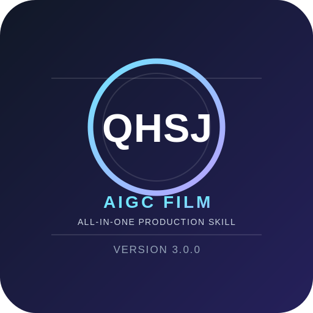

<div align="center">
  
  <h1>QHSJ AIGC 全能影视</h1>
  <p><strong>面向影视与视觉创作的全路由 Agent Skill · 全维导演创世与双区生成总引擎</strong></p>
  <p>
    <a href="https://github.com"></a>
    <a href="https://github.com"></a>
    <a href="https://github.com"></a>
    <a href="https://github.com"></a>
    <a href="https://github.com"></a>
    <a href="https://github.com"></a>
    <a href="https://github.com"></a>
    <a href="https://github.com"></a>
    <a href="https://github.com"></a>
    <a href="https://github.com"></a>
  </p>
</div>

> 🎬 面向 **AIGC 视听创作** 的工业级全流程技能包：**1 总控 + 29 能力 + 16 工作流 + 303 篇知识库 + 自动化质检**。
> 从创意立项、小说/剧本、资产锁定、空间连续性、分镜、图片/视频提示词，到模型适配、声音/VFX、API 集成与质量回归——给 AI 助手 / LLM 直接调用。

---

### 🎥 生产管线

```
📋 意图解析 → 🧭 多标签路由 → ✍️ 小说/剧本 → 🖼️ 资产锁定 → 📐 空间连续性 → 🎬 分镜导演
→ 🚀 提示词编译 → 🔌 模型适配 → 🎵 声音/VFX → ✅ 质量门禁 → 📦 交付
```

> 🔑 **核心铁律**：资产锁定是分镜资产生成的**硬门禁**。角色图、场景图、道具图未生成/核验/锁定前，工作流必须停在资产阶段，不得伪造锁定状态。

---

## 🧭 这是什么

一套**给 AI 助手执行的 AIGC 全流程创作规则库**（Agent Skill）。用户用中文白话描述目标，系统自动识别交付物、提取硬约束、选择工作流、叠加专业模块、管理依赖、执行质量门禁并交付完整结果。

它把「AIGC 视听创作」拆成一条可复用的工业化管线，核心解决四件事：

1. **不漂移** —— 角色 / 场景 / 道具**先锁定再进分镜**（Asset-First），跨镜跨集一致性有据可依；
2. **不返工** —— 多标签路由 + 依赖闭包 + 硬约束仲裁 + P0~P2 门禁 + 稿件级机检，把错误拦在生成之前；
3. **能直接投喂** —— 输出结构化提示词，整组复制即可喂给视频/图片模型；支持 Seedance / Kling / Veo / Sora / Runway / Midjourney / Flux / 即梦等全平台适配；
4. **可审计** —— 所有资源、能力、工作流、章节均有注册数据与路由图，345 文件 / 15,244 章节 / 16,718 条边全量连通。

> ⚠️ **能力边界诚实规则**：「路由已选择」≠「外部工具已调用」；「项目状态已建立」≠「跨会话永久记忆」。自动化检查通过仅证明当前包内结构与回归样例通过，不构成对所有未见输入或外部模型生成结果的绝对无缺陷保证。

## 🎯 适用场景

管线与题材解耦，凡「**创意 → 剧本 → 资产 → 分镜 → 提示词 → 模型投喂**」的 AIGC 创作都可套用：

- **AI 短剧 / 漫剧 / 短视频剧集**（高密度场景）
- **AI 广告片 / 品牌宣传片 / 概念片**
- **小说创作与小说改编剧本**（爆款骨架公式、人物欲望、剧情缺口诊断）
- **分镜预演（PREVIS）与动态分镜**
- **武打 / 动作场面设计**（现代格斗、武侠仙侠、二次元、科幻、巨物、赛车）
- **情绪戏 / 微表情专项**（FACS 表情工程、表演与情绪外化）
- **参考图 / 参考视频反推**（七要素拆图法、同风格还原）
- **空间连续性修复**（180° 轴线、站位、防穿模、穿帮排查）
- 任何需要**跨镜头角色一致性**的 AI 视频生产

## 🧩 能力架构（29 项能力 · 16 条工作流）

| 能力 ID | 中文能力 | 典型触发 |
| --- | --- | --- |
| `general_orchestration` | 总控与导演思维 | 全自动、复杂项目、全链路 |
| `novel_writing` | 小说创作 | 小说、章节、世界观、大纲、续写 |
| `screenwriting` | 编剧与剧本 | 剧本、对白、分场、短剧 |
| `short_video_content` | 短视频文案与叙事 | 短视频、口播、开头三秒、竖屏短剧 |
| `storyboard` | 分镜导演 | 分镜、镜头表、逐镜、预演 |
| `cinematography` | 摄影与镜头语言 | 景别、焦段、机位、运镜、曝光 |
| `spatial_continuity` | 空间推演与连续性 | 站位、轴线、方位、穿帮 |
| `character_design` | 角色及视觉资产 | 角色卡、外观、四视图、服装 |
| `performance_emotion` | 表演与情绪外化 | 微表情、演技、情绪转折、FACS |
| `aesthetics_style` | 美学与美术指导 | 风格、配色、灯光、导演风格 |
| `image_prompt` | 图片提示词 | 图片提示词、MJ、绘图提示词 |
| `video_prompt` | 视频提示词 | 文生视频、图生视频、首尾帧、续写 |
| `prompt_engineering` | 提示词工程 | 正负提示词、编译、投喂结构 |
| `model_adaptation` | 模型与平台适配 | Seedance、Kling、Veo、Runway、MJ、ComfyUI |
| `reverse_engineering` | 参考图/视频反推 | 反推、参考素材、复刻、同风格 |
| `asset_first` | 资产前置管线 | 资产包、锚点卡、先做设定图 |
| `asset_locking` | 资产版本锁定与引用 | 角色锁定、场景锁定、分镜引用资产 |
| `action_choreography` | 动作/打斗编排 | 打戏、攻防、武术、动作预演 |
| `vfx_physics` | VFX 与运动物理 | 粒子、爆炸、魔法、碰撞、布料、水火 |
| `audio_design` | 声音/配音/音乐 | 音效、VO/OS、配音、环境声 |
| `quality_assurance` | 质量门禁与修复 | 审查、检查、验证、找 bug、穿帮 |
| `safety_originality` | 安全与原创性 | 合规、原创、版权、内容审核 |
| `platform_adaptation` | 内容平台适配 | 抖音、小红书、B站、视频号、TikTok |
| `api_integration` | API 工程集成 | 请求、接口契约、JSON、端点 |
| `external_skill_integration` | 外部 Skill/Agent 集成 | Claude Code、Coze、Dify、千问、豆包 |
| `project_state_management` | 项目状态与连续性 | 状态机、Canon、跨轮次、台账 |
| `output_formatting` | 输出与模板 | JSON、角色卡/分镜表模板 |
| `skill_architecture_audit` | Skill 路由/代码审计 | 路由缺失、逻辑矛盾、漏洞、重构 |
| `full_production` | 全流程制作 | 完整短片、从创意到成片 |

完整触发词、依赖关系与章节索引以 `routing/route-registry.json` 为准。

## 🔒 路由仲裁与硬约束

**全局仲裁顺序**：安全与适用政策 > 用户明确硬约束 > 来源事实和项目 Canon > 因果/空间/动作/物理连续性 > 输出类型和平台硬限制 > 叙事/表演任务 > 美学与风格偏好 > 非必要装饰。

| 路由类型 | 规则 |
| --- | --- |
| **叠加路由** | 同时命中两个及以上真实交付物时全部保留 |
| **并行路由** | 模块只消费共享输入、不相互依赖时并行执行 |
| **串行路由** | 后续模块必须用前一阶段产物时必须等待 |
| **排他路由** | 用户明确"只要 X，不要 Y"时，排除不需要的交付阶段；质量/安全门禁仍执行 |
| **条件路由** | 动作、VFX、音频、模型适配等按线索激活，不机械强加 |
| **冲突路由** | 按全局仲裁顺序定位冲突，仅重跑依赖冲突字段的模块 |

> ⚠️ 用户的否定约束（"只要分镜，不要提示词""只写小说，不做视觉设计"）必须被保留，不得由依赖关系偷偷扩大交付范围。

## 🔥 核心能力亮点

| 阶段 | 能力 | 说明 |
| --- | --- | --- |
| 🧭 **路由** | 多标签自主路由 | 29 能力 + 16 工作流 + 依赖闭包；否定约束与硬约束优先 |
| ✍️ **剧本** | 小说/编剧引擎 | 爆款骨架公式库（12 种）、人物三层次欲望、剧情缺口诊断 12 项 |
| 🖼️ **资产** | Asset-First 资产包 | 角色四视图 / 场景空间图 / 道具；CHR/SCN/PRP 台账；版本锁定与依赖扫描 |
| 📐 **空间** | 空间推演引擎 | 坐标系、180° 轴线、站位声明、距离分级、防穿模、前后镜衔接、终帧锁死 |
| 🎬 **分镜** | 文武双模分镜 | 文戏微表情六阶段 / 武戏 PREVIS；故事板图·面板链 / 剧情分镜格 |
| ⚔️ **打戏** | 打斗 DSL | 五幕结构、燃点公式、12 种打斗风格、关节链速查、强度分级 |
| 🚀 **提示词** | 提示词工程 | 变量推导链五步、静帧动态六技法、超写实质感基底库、去重系统 |
| 🔌 **适配** | 全模型适配 | Seedance 2.5 / Kling / Veo 3 / Sora 2 / Runway Gen-3 / MJ / Flux / 即梦 |
| 🔍 **反推** | 反推还原引擎 | 七要素拆图法、1:1 还原 / 风格抽取、置信度标注 |
| 🎵 **声音** | 声音设计 | 三层声音结构、音色锁定、VO/OS 编织、AI 音乐提示词 |
| ✅ **质检** | P0~P2 门禁 + 机检 | 提示词静态检查 + 46 单元测试 + 139 路由评估用例 |
| 🛡️ **合规** | 安全转译 | 血腥/断肢转译为气浪/火花/重创定格，降低平台风险 |

## 🖥️ 适用平台与模型

|  | 支持 |
| --- | --- |
| **Agent 平台** | OpenClaw · WorkBuddy · 豆包智能体 / 扣子(Coze) · Dify · Claude Code · 千问 · 及通用 LLM |
| **视频模型** | Seedance 2.5 / 2.0 · Kling 3.0 · Veo 3.1 · Sora 2 · Runway Gen-3 · 即梦 |
| **图片模型** | Midjourney · Flux · Stable Diffusion / ComfyUI · 即梦 |
| **输出** | 七段式投喂提示词（Seedance）· H3 Ref2VA 六段式 · Canvas / API 结构化载荷 · 分镜看板 · 情绪曲线 |

---

## ⚙️ 快速开始

建议使用 **Python 3.10+**。运行包审计和单元测试需要 `PyYAML`；Schema 元验证需要 `jsonschema`。

```bash
# 安装依赖（审计脚本需要）
pip install PyYAML jsonschema

# 1. 查看一次路由计划（不会调用外部图像/视频模型）
python scripts/route_request.py "帮我设计角色四视图和场景资产，锁定后引用它们制作分镜图" --json

# 2. 读取路由选择、能力证据与资源候选
python scripts/route_request.py "只要分镜，不要提示词" --json

# 3. 检查提示词文件
python scripts/validate_prompt.py prompt.txt --type video

# 4. 运行全包结构、引用、哈希、Schema、路由图审计
python scripts/audit_package.py

# 5. 运行自然语言路由评估集
python scripts/run_evals.py

# 6. 运行单元回归测试
python -B -m unittest discover -s tests -v

# 7. 工作流/资源/文档变更后，重建路由注册、图与清单
python scripts/rebuild_routing_assets.py
python scripts/audit_package.py
```

**给 AI 助手的最小执行序列**：读 `SKILL.md` → `intent-analysis` 解析意图与硬约束 → 选择主工作流 + 依赖闭包 → 资产锁定（若涉及视觉）→ 空间连续性台账 → 分镜 → 提示词编译与模型适配 → `validate_prompt.py` 机检 → 质量门禁 → 交付。

### 🧮 常用指令

`/写剧本` · `/台词诊断` · `/数字资产包` · `/素材形态` · `/做分镜` · `/语速自检` · `/生成图片提示词` · `/生成视频提示词` · `/反推参考图` · `/空间推演` · `/情绪曲线` · `/模型适配` · `/质量审查` · `/全链路制作`

---

## 📦 项目结构

```text
QHSJ-AIGC-全能影视/
├── SKILL.md                       # 主入口：执行契约、能力路由、工作流、使用说明
├── README.md                      # 项目说明与快速开始（本文件）
├── CHANGELOG.md                   # 版本历史
├── AUDIT_REPORT.md                # 离线审计与回归结果
├── MANIFEST.json                  # 文件清单、大小和 SHA-256
├── LICENSE
├── assets/
│   ├── logo.png                   # QHSJ 品牌标识
│   └── logo.svg
├── routing/
│   ├── route-registry.json        # 能力/工作流/资源/章节/触发词注册表
│   ├── route-registry.schema.json
│   └── route-graph.json           # 能力、依赖、工作流、资源与章节关系图
├── workflows/                     # 16 条宏观工作流（YAML）
├── references/                    # 303 篇知识库正文（含兼容别名）
├── schemas/                       # 项目状态与分镜数据契约
├── templates/                     # 资产锁定台账、空间连续性台账等模板
├── scripts/
│   ├── route_request.py           # 中文自然语言路由预览
│   ├── rebuild_routing_assets.py  # 重建注册表、路由图与 Manifest
│   ├── audit_package.py           # 包结构/哈希/引用/Schema/路由图审计
│   ├── run_evals.py               # 路由评估集回归
│   └── validate_prompt.py         # 提示词静态检查
├── tests/                         # 确定性单元测试
└── evals/                         # 中文路由与否定约束用例
```

---

## 📜 更新历史

- **v3.0.0**（2026-10-18）— 全量路由、资产锁定与空间连续性版。统一命名 QHSJ AIGC 全能影视；345 文件 / 29 能力 / 16 工作流 / 303 篇知识库；87 组字节级重复正文无损去重为兼容别名；新增 `asset_locking` 能力与 `asset-lock` 工作流；空间、距离、朝向、视线账本协议；多角色审查协议；15-qhsj-master-engine.md 结构整改（畸形表格修复、重复精简块去重、目录补全）。
- **v2.2.3** — 全量路由连通与执行边界修复；统一版本号；修正审计依赖过宽。
- **v2.2.2** — 全量可审计路由闭包版；新增 route-graph.json。
- **v2.1.x** — 路由与架构整改；新增完整 route-registry.json；六类专业工作流。
- **v2.0.0** — 全能重构版；动态路由引擎；14 个核心 references 模块。

完整历史见 [CHANGELOG.md](CHANGELOG.md)。

---

## 📄 许可证

本项目采用 **MIT License**，完整条款见 [LICENSE](LICENSE)。

---

## 👤 关于作者 & 问题反馈

<div align="center">
  
  <p><strong>QHSJ AIGC 全能影视</strong> · 作者</p>
</div>

如果在使用中遇到 **bug、逻辑漏洞、路由缺失、模型适配问题**，或有 **功能建议、合作意向**，欢迎通过以下方式联系：

| 联系方式 | 账号 |
| --- | --- |
| 📱 微信 | `C0053224QM` |
| 📧 QQ 邮箱 | [3340565974@qq.com](mailto:3340565974@qq.com) |
| 📧 Google 邮箱 | [j3340565974@gmail.com](mailto:j3340565974@gmail.com) |

> 💡 **反馈建议**：提交问题时请附上触发的自然语言原文、期望行为、实际行为，以及（若涉及生成）目标模型与画幅。作者会尽快核实并修复。

---

<div align="center">
  <p><strong>Made with ❤️ for AIGC Creators</strong></p>
  <p>把创造还给导演，把技术交给我。</p>
</div>
